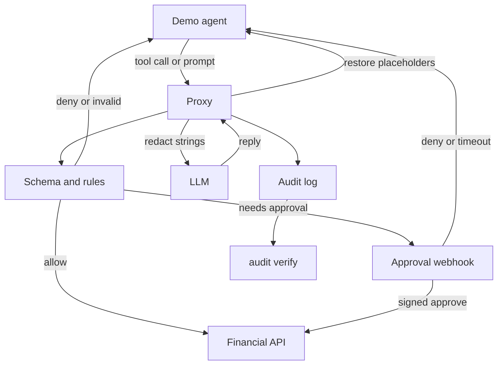

# guardrail-proxy

guardrail-proxy sits in front of a financial AI agent and decides what is allowed to happen. Tool calls that move money, read a balance, or change a record are checked against a strict schema and a deterministic rule file before they reach the API. Transfers over $500 wait for a signed human approval. Prompts are scrubbed of card numbers, account numbers, and other pattern-matched PII before they reach a model, and the originals are put back only in the reply. Every one of those steps is an append-only, Ed25519-signed hash chain, so a later edit to the log is visible.

## Architecture



The default demo never leaves the machine. `cmd/demo` starts a stand-in bank, a stand-in approver, and a stand-in model, then plays one scenario through the real proxy.

## Quickstart

From the repo root:

```bash
go run ./cmd/demo
```

`make demo` does the same thing. The first run compiles the packages. No API key is required. A built `./cmd/demo`, timed with bash `time` on this machine after `go build`, finished in 0.027s and then 0.019s of real time. That does not include compilation.

The walkthrough reads a balance, sends a $200 transfer, sends a $750 transfer once with the approver set to approve and once with it set to deny, rejects a float amount, sends a prompt containing an email address and shows it restored, runs `audit verify`, then flips one byte and shows verify stopping on that line.

To send the prompt step to a real OpenAI-compatible endpoint instead of the stand-in:

```bash
go run ./cmd/demo -llm https://api.openai.com/v1/chat/completions -llm-model gpt-4o-mini
```

The bearer token is `OPENAI_API_KEY` or `-llm-key`. It is forwarded to the model and is not printed.

To run the pieces yourself, the flags are `-upstream`, `-approval-webhook`, `-approval-secret` or `GUARDRAIL_APPROVAL_SECRET`, `-llm`, `-audit-log`, and `-audit-key`. `go run ./cmd/audit keygen -out audit.key` writes the private key and `audit.pub`. Do not commit the private key.

## Threat model and limits

The agent is untrusted. The proxy is the boundary in front of the bank and the model. It rejects malformed tool calls, blocks transfers the rules deny, holds transfers over $500 until a signed approval comes back, strips pattern-matched PII from prompts, and records the decisions in a log that detects edits.

It does not authenticate the caller, and it does not replace the bank's own authorization. The sample $500 rule compares `amount_cents` with 50000. It does not convert currencies. Approval is a synchronous webhook call. If the approver is down or slow, the proxy denies the call after the timeout. A person who holds the audit private key can rewrite the chain. The key is what the signatures depend on.

PII detection is pattern matching. It catches emails, formatted and E.164 phone numbers, dashed or spaced SSNs outside the invalid ranges, card numbers of 13 to 19 digits that pass the Luhn check, ABA routing numbers, account numbers written next to a label such as `account` or `checking`, and IBANs that pass the mod-97 check. It does not catch names or street addresses. It misses obfuscated text (`ada at example dot com`), a bare ten-digit phone number, and an account number with no nearby label. A 16-digit order id that passes Luhn, or a 9-digit id that passes the ABA check, can still be flagged. Tool calls to the bank are not redacted. The bank has to see the account. The audit log stores a SHA-256 of the tool-call bytes and redaction counts by type. It does not store prompt text or the placeholder map.

## Measured numbers

These are the benchmark runs from milestones 1–4, on Go 1.22.2, linux/amd64, Intel Xeon, `GOMAXPROCS` 4. They are the runs as recorded then, not a new measurement.

| Milestone | Measurement | Runs (ns/op) | Median |
|---|---|---|---|
| 1 | One policy check, exactly $500.00 allowed | 6551, 6551, 6488, 6489, 6661 | 6551 ns/op; 5496 B/op; 115 allocs/op |
| 1 | One policy check, $500.01 needs approval | 6403, 6436, 6440, 6416, 6406 | 6416 ns/op; 5496 B/op; 115 allocs/op |
| 2 | Sign and check one approval, no network | 3656, 3666, 3689, 3749, 3770 | 3689 ns/op; 3128 B/op; 35 allocs/op |
| 2 | Proxy allow, no webhook, localhost upstream | 52333, 50766, 51074, 50345, 51058 | 51058 ns/op; 222 allocs/op |
| 2 | Proxy over $500 with an immediate approve | 162754, 163195, 163075, 162088, 161474 | 162754 ns/op; 405 allocs/op; 111696 ns more than the allow row |
| 3 | Redact a 572-byte prompt | 100828, 101201, 100564, 101189, 101768 | 101189 ns/op; 54 allocs/op; 4101–4112 B/op |
| 3 | Labeled corpus, 27 items | 12 PII strings caught, 25 strings kept | 0 false positives, 0 false negatives, 3 known misses |
| 4 | Audit append, including fsync of the log and the tip | 545288, 466533, 446170, 475375, 472600 | 472600 ns/op; 80 allocs/op |
| 4 | Verify a log of 10,000 entries | 421053507, 422611698, 419212258 | 421053507 ns, which is 421.05 ms |

Test counts when those milestones landed: 210, 234, 279, and 294 leaf tests. After the demo, `go test -json` reports 296 leaf tests across 58 test functions.

## Tests

```bash
go test ./...
go vet ./...
go test -race ./...
```

GitHub Actions runs those three on push and pull request. `make test` runs them locally. The suite is 296 leaf tests.

## Layout

- `cmd/demo` plays the scenario.
- `cmd/proxy` is the server. `cmd/audit` generates a key and verifies a log.
- `internal/schema` and `internal/rules` check one tool call.
- `internal/approval` is the signed webhook round trip.
- `internal/redact` and `internal/llm` redact a prompt and restore the reply.
- `internal/audit` is the hash-chained log.
- `internal/fakeupstream`, `internal/fakeapprover`, and `internal/fakellm` are the stand-ins.

## License

MIT.
